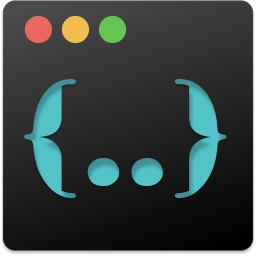

# tera-cli

<figure>

</figure>

[tera](https://github.com/Keats/tera) is a template engine written in Rust and inspired by Jinja2. It allows merging some data called `context data` into a template and produces a new output. This project, `tera-cli`, is a command line for the [tera template engine](https://github.com/Keats/tera).

This project is called `tera-cli` but the command installed on your system is simply `tera`.

`tera-cli` offers powerful features related to your environment variables, allowing you to control the output **both** from the context data you pass but also from the ENV variables set on your system.

## Install

```bash
cargo install --git https://github.com/chevdor/tera-cli
```

## Documentation

Full docs (a basic example, ENV variables, includes & inheritance, CLI reference): **https://chevdor.k8s.chevdor.cc/tera-cli/#/**
